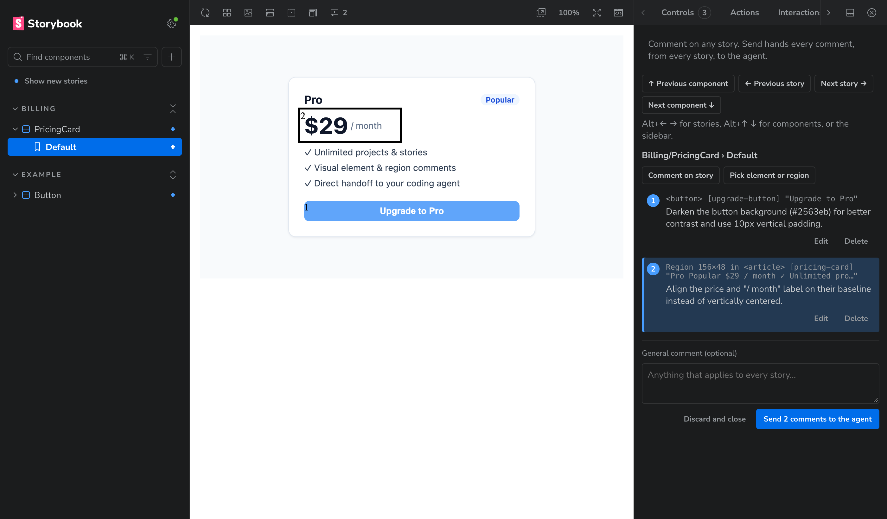

# storybook-review

Review Storybook stories in your browser and send the feedback straight to your coding agent.



## How it works

1. Ask your agent to review a component or story — it launches Storybook (or reuses a running one) and opens a browser tab with the **Review** panel.
2. Leave comments on a whole story, click an element, or drag a region (`⌘⇧C` / `Ctrl+Shift+C`) across as many stories as you need.
3. Click **Send** — your agent receives every comment with its story file, test ID, accessible role/name, CSS path, bounding box, globals, and changed args.

The Review UI only appears in tabs opened by the CLI, so regular Storybook sessions stay untouched.

## Install

### 1. Install the agent plugin

| Harness | Command |
|---|---|
| Claude Code | `/plugin marketplace add pAIrprogio/ai-marketplace` then `/plugin install storybook-review@ai-marketplace` |
| [Agent Plugins](https://agent-plugins.org) (OpenCode, Codex, …) | `agentplugins add github:pAIrprogio/storybook-review//plugins/storybook-review` |
| [Agent Skills](https://skills.sh) | `npx skills add pAIrprogio/storybook-review` |

### 2. Add the Storybook addon

Requires **Storybook 10** and **Node 22+** (or **Bun**).

```bash
npm install -D @pairprog/storybook-addon-review
```

Register it in `.storybook/main.ts`:

```ts
addons: ["@pairprog/storybook-addon-review"],
```

See [packages/storybook-addon-review](./packages/storybook-addon-review/README.md) for CLI options and environment variables.
