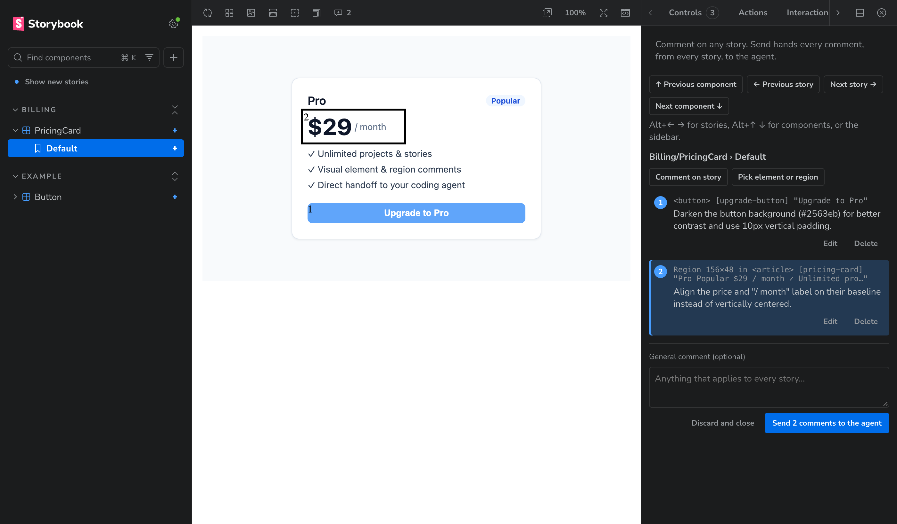

# @pairprog/storybook-addon-review

Review Storybook stories in your browser and hand structured comments to any coding agent.

Comment on a whole story, click an element, or drag a region across any number of stories, then click **Send**. Your agent receives each comment with its story file, test ID, accessible role/name, CSS path, bounding box, globals, and changed args. With the [browser extension](../storybook-review-extension), each comment also carries a screenshot of what you saw when you commented.



## Recommended: install the agent plugin

Install the [`storybook-review`](https://github.com/pAIrprogio/storybook-review) plugin for your coding agent — it launches sessions automatically and guides setup in the right workspace folder on first run.

| Harness | Command |
|---|---|
| Claude Code | `/plugin marketplace add pAIrprogio/ai-marketplace` then `/plugin install storybook-review@ai-marketplace` |
| [Agent Plugins](https://agent-plugins.org) (OpenCode, Codex, …) | `agentplugins add github:pAIrprogio/storybook-review//plugins/storybook-review` |
| [Agent Skills](https://skills.sh) | `npx skills add pAIrprogio/storybook-review` |

## Manual Storybook setup

Requires **Storybook 10** and **Node 22+** (or **Bun**).

1. Install the package in your Storybook workspace:
   ```bash
   npm install -D @pairprog/storybook-addon-review
   ```
2. Register it in `.storybook/main.ts`:
   ```ts
   addons: ["@pairprog/storybook-addon-review"],
   ```

## How it works

- **Lifecycle:** Reuses a Storybook already serving the addon, or starts the project's Storybook (with Bun in Bun projects, Node otherwise) and stops it after **Send**.
- **Long sessions:** If you take longer than 8 minutes, the session prints `PENDING <id>` so the agent resumes waiting with `--wait <id>`.
- **Zero noise:** The Review panel and toolbar button only appear in tabs opened by a review session ([ADR 0003](./docs/adr/0003-ui-only-while-an-agent-listens.md)).
- **Screenshots:** If the [browser extension](../storybook-review-extension) is installed, each comment's screenshot is saved as `comment-<n>.png` and printed in the agent's output. Without it, a notice in the panel points to the install steps and comments go out without screenshots.

## Running the CLI directly (without the plugin)

If your harness doesn't use the plugin, invoke the `storybook-review` binary directly from the Storybook workspace:

```bash
storybook-review [<story ID or title prefix>] [--port 6006] [--dir <folder>]
storybook-review --wait <session id>
```

## Environment variables

| Variable | Effect |
|---|---|
| `STORYBOOK_REVIEW_WAIT_MS` | Wait timeout before printing `PENDING` (default: `480000`) |
| `STORYBOOK_REVIEW_NO_OPEN=1` | Do not open a browser window automatically |
| `STORYBOOK_REVIEW_SELF` | Command printed for follow-up runs |

## Architecture decisions

See [docs/adr](./docs/adr).
